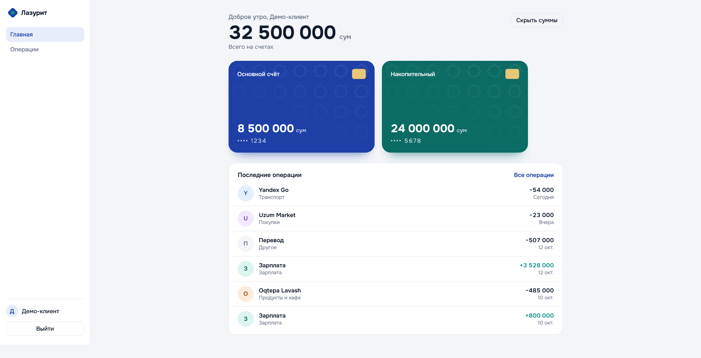

# Лазурит: интернет-банк (демо)

Фронтенд личного кабинета банка: вход, счета и карты, история операций с поиском, фильтрами и пагинацией.

**Демо:** https://online-bank-gamma.vercel.app/login
**Вход:** логин `demo`, пароль `demo123`

> Бэкенда нет: сервер имитирует [MSW](https://mswjs.io) прямо в браузере, а данные операций генерируются. Это учебный проект, настоящих данных в нём нет.




## Что умеет

- Вход по логину и паролю, защищённые страницы, выход
- Автовыход по бездействию: через 5 минут, за 30 секунд до этого предупреждение с кнопкой «Остаться»
- Выход при ответе сервера 401, на экране входа объяснение, почему так вышло
- Счета и карты, общий баланс, кнопка «Скрыть суммы»
- История операций: поиск (с задержкой 300 мс), фильтр по категории, пагинация
- Поиск, категория и страница хранятся в адресе: после обновления страницы фильтры остаются, ссылкой можно поделиться
- Состояния загрузки (скелетоны), ошибок и пустого результата
- Адаптив: боковое меню на компьютере, верхняя и нижняя панели на телефоне
- Клавиатурная навигация и видимый фокус, `prefers-reduced-motion` уважается

## Стек

React, TypeScript, Vite, React Router, TanStack Query, MSW, Vitest

## Запуск

```bash
npm install
npm run dev
npm test
```

## Как устроено

- `src/lib/api.ts`: общий клиент запросов; любой 401 с токеном вызывает выход из системы в одном месте
- `src/auth/AuthContext.tsx`: сессия в `sessionStorage` (живёт, пока открыта вкладка); при выходе очищается кэш запросов, чтобы данные не достались следующему пользователю
- `src/hooks/useIdleTimeout.ts`: отсчёт бездействия по `Date.now()`, поэтому выход срабатывает вовремя, даже если вкладка была в фоне
- `src/pages/OperationsPage.tsx`: состояние фильтров живёт в URL (`useSearchParams`), значения из адреса проверяются перед использованием
- `src/mocks/handlers.ts`: фейковое API с проверкой токена, поиском, фильтром и пагинацией
- `src/lib/format.ts`: форматирование денег, дат и приветствия (покрыто тестами)

## Что бы я улучшил

- Хранить токен в httpOnly-cookie, а не в `sessionStorage` (на фронтенде без настоящего бэкенда это невозможно)
- Добавить страницу переводов с обновлением баланса после операции
- Тесты на компоненты (React Testing Library) и сквозные тесты (Playwright)
- Виртуализация списка при тысячах операций